<div align="center">

# 👋 Hola, soy Christian Farias

### Contabilidad · Data Analytics · Tecnología

**De los datos a las decisiones. De las ideas a las soluciones.**

📍 Tumbes, Perú · 🎓 Contabilidad — UNTUMBES · 10.º ciclo (Próximo a egresar)

<br>

<a href="https://github.com/Christian-hanma">
  
</a>
<a href="https://portafolio-tau-seven-89.vercel.app/">
  
</a>
<a href="https://www.linkedin.com/in/christian-jesus-farias-prieto/">
  
</a>
<a href="https://blog-ctrl-contable.vercel.app/">
  
</a>
<a href="mailto:Christian22fariasprieto@gmail.com">
  
</a>

</div>

---

## 💻 `$ whoami --profile`

<p align="center">
  
</p>

<br>

---

## 🧭 Sobre mí

Estudiante de **Contabilidad en la UNTUMBES** (10.º ciclo, próximo a egresar) con un perfil híbrido que conecta **finanzas, análisis de datos, gestión pública y desarrollo de herramientas digitales**.

Cuento con experiencia en **formulación y presupuesto de proyectos de innovación (I+D+i)**, **tesorería en el sector público (SIAF Web, PDT PLAME)**, **fiscalización y logística electoral (JNE / ONPE)** y **asistencia contable-tributaria (SUNAT, PDT 621)**.

Mi objetivo es transformar información financiera y administrativa compleja en **datos estructurados, tableros de control y software funcional** que faciliten la toma de decisiones y aceleren la automatización operativa.

---

## 🚀 Lo que estoy construyendo

<table>
<tr>
<td width="50%">

### 📊 Data Analytics & Finanzas

Actualmente profundizando en:

* **SQL & Bases de Datos:** Consultas avanzadas, agregaciones, joins y modelado relacional (PIT-UNI).
* **Power BI & Business Intelligence:** Modelado dimensional, DAX, tableros dinámicos y storytelling visual (PIT-UNI).
* **Gestión Financiera con Excel:** Modelos de evaluación financiera, flujos de caja y análisis de costos (PIT-UNI).
* **Python & pandas:** Limpieza de datos (EDA), transformación ETL y automatización contable.
* **Métricas & KPI:** Ratios financieros, cumplimiento tributario SUNAT e indicadores presupuestales.

</td>

<td width="50%">

### ⚙️ Desarrollo de Herramientas

Construyo proyectos orientados a resolver problemas reales:

* **ContaPanel:** Sistema de gestión para estudios contables y control de vencimientos SUNAT.
* **Gestor de Proyectos:** App de escritorio nativa (Python/Tkinter/SQLite) integrada con OneDrive y Obsidian.
* **FLUJO:** ERP y herramienta financiera para control de ingresos, gastos y medios de pago.
* **Portafolio Web & CMS:** Plataforma personal administrable en Next.js 15, TypeScript y Supabase.
* **Automatización Administrativa:** Scripts y matrices para control de proyectos e inventarios.

</td>
</tr>
</table>

---

## 🎓 Formación Continua & Certificaciones

<table width="100%">
  <tr>
    <td width="50%" valign="top">
      <h3>📊 Data, Analytics & Herramientas Digitales</h3>
      <ul>
        <li>
          
          <br>
          <b>SQL — Base de Datos 1</b>
          <br>
          <sub><i>Universidad Nacional de Ingeniería (PIT-UNI) · Certificado próximamente</i></sub>
        </li>
        <br>
        <li>
          
          <br>
          <b>Power BI — Básico</b>
          <br>
          <sub><i>Universidad Nacional de Ingeniería (PIT-UNI) · Certificado próximamente</i></sub>
        </li>
        <br>
        <li>
          
          <br>
          <b>Gestión Financiera con Excel</b>
          <br>
          <sub><i>Universidad Nacional de Ingeniería (PIT-UNI) · Certificado próximamente</i></sub>
        </li>
        <br>
        <li>
          
          <br>
          <b>Excel de Intermedio a Avanzado</b>
          <br>
          <sub><i>Certificado de finalización · Modelado, funciones y tablas dinámicas (2026)</i></sub>
        </li>
        <br>
        <li>
          
          <br>
          <b>Certificado de Excel — Santander Open Academy</b>
          <br>
          <sub><i>Santander Open Academy · Análisis y herramientas de productividad (2026)</i></sub>
        </li>
        <br>
        <li>
          
          <br>
          <b>Domina la IA con Gemini</b>
          <br>
          <sub><i>Google · Productividad e Inteligencia Artificial Aplicada (2026)</i></sub>
        </li>
      </ul>
    </td>
    <td width="50%" valign="top">
      <h3>🏛️ Gestión Pública & Sistemas Estatales</h3>
      <ul>
        <li>
          
          <br>
          <b>SIAF-SP — Sistema Integrado de Administración Financiera</b>
          <br>
          <sub><i>Certificación ESCADE Perú · Módulo administrativo, giros y operaciones (2026)</i></sub>
        </li>
        <br>
        <li>
          
          <br>
          <b>SIGA-MEF — Sistema Integrado de Gestión Administrativa</b>
          <br>
          <sub><i>Certificación ESCADE Perú · Logística, pedidos y adquisiciones del Estado (2026)</i></sub>
        </li>
        <br>
        <li>
          
          <br>
          <b>Presupuesto Público</b>
          <br>
          <sub><i>Certificación ESCADE Perú · Clasificadores, fases y ejecución presupuestal (2026)</i></sub>
        </li>
        <br>
        <li>
          
          <br>
          <b>PLADICO / PLADICOP</b>
          <br>
          <sub><i>Certificación ESCADE Perú · Planes de desarrollo y concertación (2026)</i></sub>
        </li>
        <br>
        <li>
          
          <br>
          <b>Gestión Presupuestal y Financiera en el Sector Público</b>
          <br>
          <sub><i>MINPE · Diplomado de especialización 128 horas (2026)</i></sub>
        </li>
        <br>
        <li>
          
          <br>
          <b>Logística y Abastecimiento Público</b>
          <br>
          <sub><i>MINPE · Contrataciones estatales y cadena de suministros 128 horas (2025)</i></sub>
        </li>
        <br>
        <li>
          
          <br>
          <b>Gestión de Almacenes e Inventario</b>
          <br>
          <sub><i>MINPE · Control patrimonial y registros de inventario 128 horas (2026)</i></sub>
        </li>
      </ul>
    </td>
  </tr>
  <tr>
    <td width="50%" valign="top">
      <h3>📋 Trámite, Control & Normativa Estatal</h3>
      <ul>
        <li>
          
          <br>
          <b>Trámite Documentario y Gestión de Archivos</b>
          <br>
          <sub><i>ACIST Perú · Especialización 150 horas académicas (2026)</i></sub>
        </li>
        <br>
        <li>
          
          <br>
          <b>Calidad del Servicio y Atención al Ciudadano</b>
          <br>
          <sub><i>MINPE · Procesos administrativos orientados al usuario 128 horas (2026)</i></sub>
        </li>
        <br>
        <li>
          
          <br>
          <b>Delitos contra la Administración Pública y Corrupción</b>
          <br>
          <sub><i>MINPE · Marco legal, ética, integridad y transparencia pública 128 horas (2025)</i></sub>
        </li>
        <br>
        <li>
          
          <br>
          <b>MOOC Rumbo a las ERM 2026</b>
          <br>
          <sub><i>Escuela Electoral y de Gobernabilidad del JNE (2026)</i></sub>
        </li>
      </ul>
    </td>
    <td width="50%" valign="top">
      <h3>💼 Tributación, Finanzas & Eventos</h3>
      <ul>
        <li>
          
          <br>
          <b>XXX Convención Nacional de Tributación — TRIBUTA 2025</b>
          <br>
          <sub><i>Colegio de Contadores Públicos de Tumbes / Junta de Decanos (20 hrs lectivas)</i></sub>
        </li>
        <br>
        <li>
          
          <br>
          <b>Regímenes Tributarios</b>
          <br>
          <sub><i>Gerencia Regional de Trabajo y Promoción del Empleo de Lambayeque (2026)</i></sub>
        </li>
        <br>
        <li>
          
          <br>
          <b>Estrategias para Mejorar la Organización y Productividad</b>
          <br>
          <sub><i>Gerencia Regional de Trabajo y Promoción del Empleo de Lambayeque (2026)</i></sub>
        </li>
        <br>
        <li>
          
          <br>
          <b>Encuentro Universitario Tributario y Aduanero</b>
          <br>
          <sub><i>SUNAT · Normativa fiscal, aduanera y tributación formal (2020)</i></sub>
        </li>
        <br>
        <li>
          
          <br>
          <b>VIII Jornada Internacional de Investigación Científica</b>
          <br>
          <sub><i>Universidad Nacional de Tumbes · Participante asistente (2020)</i></sub>
        </li>
      </ul>
    </td>
  </tr>
</table>

---

## 🛠️ Tecnologías

### 📊 Data & Analytics

<p>


</p>

### 💻 Desarrollo

<p>


</p>

### 🗄️ Datos, Backend & Cloud

<p>


</p>

### 🔧 Herramientas & Entornos

<p>


</p>

---

## ⭐ Proyectos destacados

<table>
<tr>
<td width="50%">

### 📋 ContaPanel

Sistema orientado a la gestión de estudios contables.

Centraliza información de clientes, obligaciones tributarias, vencimientos SUNAT y herramientas de análisis con dashboard individual protegido por PIN.

**En desarrollo**

[📂 Repositorio](https://github.com/Christian-hanma/conta-panel) · [🌐 Demo en vivo](https://christian-hanma.github.io/conta-panel/panel_control.html)

</td>

<td width="50%">

### 🗂️ Gestor de Proyectos

Aplicación de escritorio para organizar proyectos, tareas y progreso.

Integra lectura heurística en OneDrive, notas Markdown sincronizadas con Obsidian y almacenamiento local SQLite.

**Python · Tkinter · SQLite**

[📂 Repositorio](https://github.com/Christian-hanma/Gestor-de-proyectos)

</td>
</tr>

<tr>
<td width="50%">

### 💰 FLUJO

Herramienta modular para control de finanzas personales y gestión por métodos de pago (bancos y billeteras digitales).

Incluye seguimiento de saldos, balance patrimonial y conciliación de efectivo.

**JavaScript · Firebase**

*Próximamente disponible*

</td>

<td width="50%">

### 🌐 Portafolio Contable

Mi plataforma web profesional para presentar proyectos, experiencia y artículos técnicos.

Incluye un panel administrativo propio (`/admin`) con autenticación y base de datos relacional.

**Next.js 15 · TypeScript · Supabase**

[🌐 Sitio Web](https://portafolio-tau-seven-89.vercel.app/)

</td>
</tr>
</table>

---

## 📚 Ruta de Aprendizaje

```text
Data Analytics & Finanzas (PIT-UNI & Autodidacta)
│
├── 01 · SQL · Base de Datos 1 (PIT-UNI · En curso)
├── 02 · Power BI · Básico (PIT-UNI · En curso)
├── 03 · Gestión Financiera con Excel (PIT-UNI · En curso)
├── 04 · Python & pandas (Tratamiento de datos y EDA)
├── 05 · Modelado de datos relacional & ETL
├── 06 · Métricas financieras, dimensiones y KPI
└── 07 · Dashboards interactivos & Storytelling
```

Mi objetivo es aplicar estas herramientas técnicas a **problemas contables, financieros, presupuestales y administrativos reales**.

---

## 📈 GitHub

<div align="center">


</div>

<br>

<div align="center">


</div>

---

## 📫 Contacto & Colaboración

<div align="center">

¿Tienes un proyecto, consulta sobre analítica contable o propuesta de colaboración? Escríbeme.

[✉️ **Christian22fariasprieto@gmail.com**](mailto:Christian22fariasprieto@gmail.com)

</div>

---

<div align="center">

### 💡 Datos para entender. Tecnología para construir. Contabilidad para decidir.

<br>

<a href="https://github.com/Christian-hanma">
  
</a>

<a href="https://www.linkedin.com/in/christian-jesus-farias-prieto/">
  
</a>

</div>
